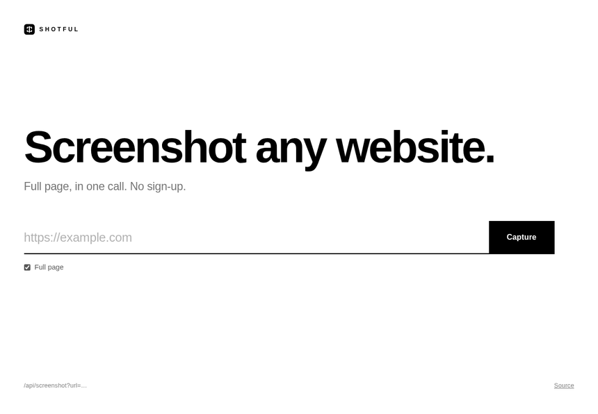

# Shotful

Screenshot any website — the whole page, in one call.



Paste a URL on the site and you get the full page back as a single image. The same thing is available as an API.

## Files

- `public/` — the website (HTML, CSS, JS, icon)
- `functions/api/screenshot.js` — the API
- `wrangler.toml` — config

## Deploy

On Cloudflare Pages:

1. Create a Pages project from this repo.
2. Build command `npm install`, build output directory `public`.
3. Add a Browser Rendering binding named `BROWSER` (Settings → Functions → Bindings).

Site goes live at `https://<project>.pages.dev`.

## API

```
GET /api/screenshot?url=https://example.com
```

| param | default | |
|---|---|---|
| `url` | — | required |
| `fullPage` | `true` | `false` = viewport only |
| `width` | `1440` | 320–3840 |
| `format` | `png` | `png` or `jpeg` |
| `download` | `false` | `true` = raw image |

Opened in a browser, the URL returns the image directly. From code you get JSON (a base64 image) unless you pass `download=true`.

## License

MIT
