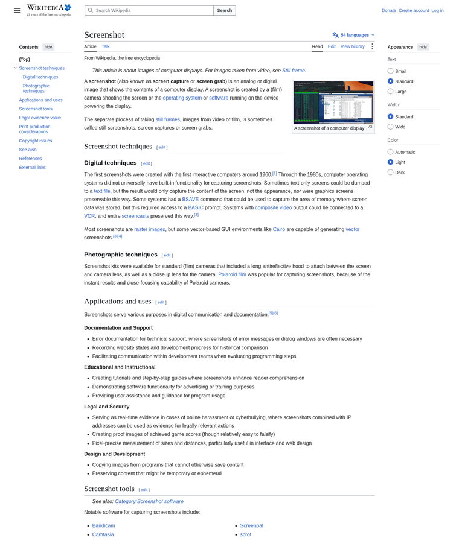

# Website Screenshot API

**Give it any URL, get back a full-page screenshot.** One HTTP call, no browser automation on your side.

[](https://github.com/rajforsuree/website-screenshot-api/actions/workflows/ci.yml)
[](LICENSE)
[](https://nodejs.org)



> Example output — a real 1440×4098px full-page capture produced by this API.

---

## Why this one

Screenshotting a page looks like a one-liner. Shipping it to production is not. This project already handles the four things that bite people:

| Problem | What this does |
|---|---|
| **SSRF** — a user passes `http://169.254.169.254` and your server fetches your cloud metadata | Resolves the hostname and blocks localhost, private ranges, link-local and metadata IPs |
| **Very long pages** — Chromium can't render a single image taller than ~16384px | Auto-detects tall pages, captures them in tiles and stitches vertically |
| **Lazy loading** — half the images come out blank | Auto-scrolls the whole page before capturing |
| **Load** — a headless browser is heavy, ten at once OOM the box | Built-in concurrency queue with a configurable cap |

Plus: page timeouts, guaranteed cleanup, JPEG/PNG, configurable width/scale, and an optional ad/font blocking mode.

## Quick start

```bash
git clone https://github.com/rajforsuree/website-screenshot-api.git
cd website-screenshot-api
npm install
CHROME_PATH=/usr/bin/chromium npm start
```

Open `http://localhost:3000` for a tiny built-in demo UI, or hit the API directly:

```bash
curl "http://localhost:3000/screenshot?url=https://example.com&download=true" -o shot.png
```

## API

### `GET /screenshot`

| param            | default | notes                                        |
|------------------|---------|----------------------------------------------|
| `url`            | —       | **required**, `http(s)://` only              |
| `fullPage`       | `true`  | `false` = just the viewport                  |
| `width`          | `1440`  | 320–3840                                     |
| `format`         | `png`   | `png` or `jpeg`                              |
| `quality`        | `85`    | jpeg only, 1–100                             |
| `scale`          | `1`     | device scale factor, 1–2 (2 = retina)        |
| `blockAds`       | `false` | skip fonts/media for a faster capture        |
| `download`       | `false` | `true` = return the raw image bytes          |

### `POST /screenshot`

Same options as a JSON body:

```bash
curl -X POST http://localhost:3000/screenshot \
  -H 'content-type: application/json' \
  -d '{"url":"https://example.com","fullPage":true,"format":"jpeg","width":1440}'
```

### `GET /health`

Returns `{ "ok": true, "running": 0, "queued": 0 }` — wire this to your load balancer.

### JSON response

```json
{
  "url": "https://example.com/",
  "format": "png",
  "width": 1440,
  "height": 4098,
  "stitched": false,
  "bytes": 67397,
  "base64": "iVBORw0KGgo..."
}
```

> **Production tip:** don't ship base64 in the response. Upload the buffer to S3/R2 and return a signed URL. The exact spot is marked in `server.js`.

## Configuration

| env var           | default             | notes                                   |
|-------------------|---------------------|-----------------------------------------|
| `PORT`            | `3000`              |                                         |
| `CHROME_PATH`     | `/usr/bin/chromium` | path to the Chromium binary             |
| `MAX_CONCURRENCY` | `3`                 | simultaneous screenshots                |
| `NAV_TIMEOUT_MS`  | `30000`             | per-page navigation timeout             |
| `PROXY_SERVER`    | —                   | e.g. `http://proxy:3128` if you need one |

## Deploy

**Docker** (recommended — Chromium's shared libs are the usual pain point):

```bash
docker build -t shot-api .
docker run -p 3000:3000 shot-api
# or
docker compose up
```

**Or** on a VM: install `chromium`, then `CHROME_PATH=/usr/bin/chromium node server.js` behind Nginx / a load balancer.

> Avoid serverless (Lambda / Vercel) unless you bundle Chromium — the cold-start and binary-size cost isn't worth it. A small always-on container is cheaper and simpler here.

## Project structure

```
.
├── server.js               # the API
├── test.js                 # smoke test (SSRF guard + real capture)
├── public/index.html       # built-in demo UI
├── Dockerfile              # chromium + app
├── docker-compose.yml
└── .github/workflows/ci.yml
```

## Test

```bash
npm test
```

Runs the SSRF guard against known-bad hosts and performs one real full-page capture.

## License

[MIT](LICENSE) © Rajesh Paswan
